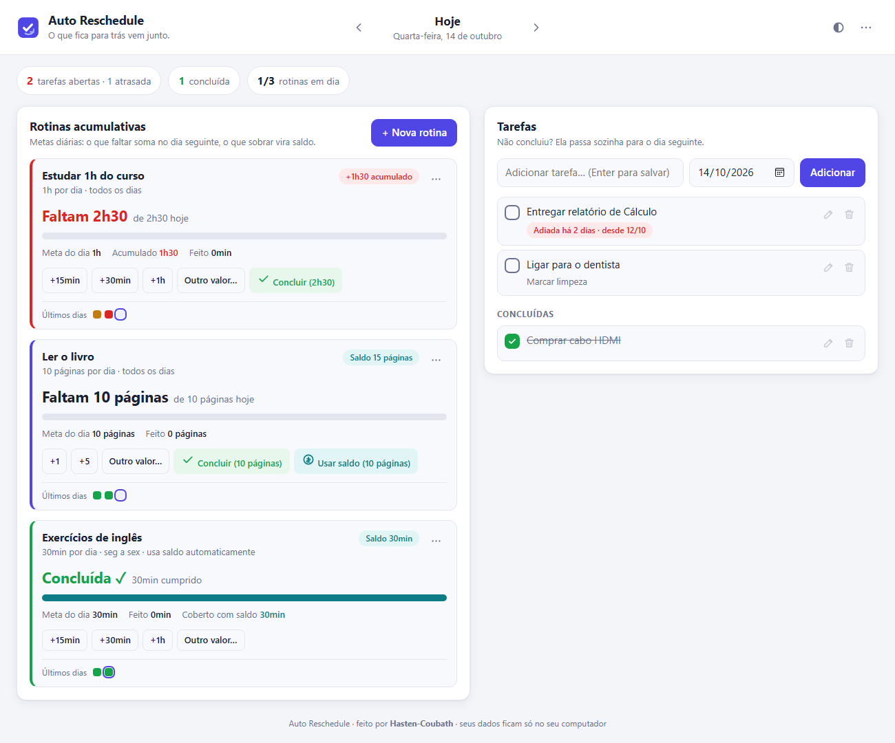
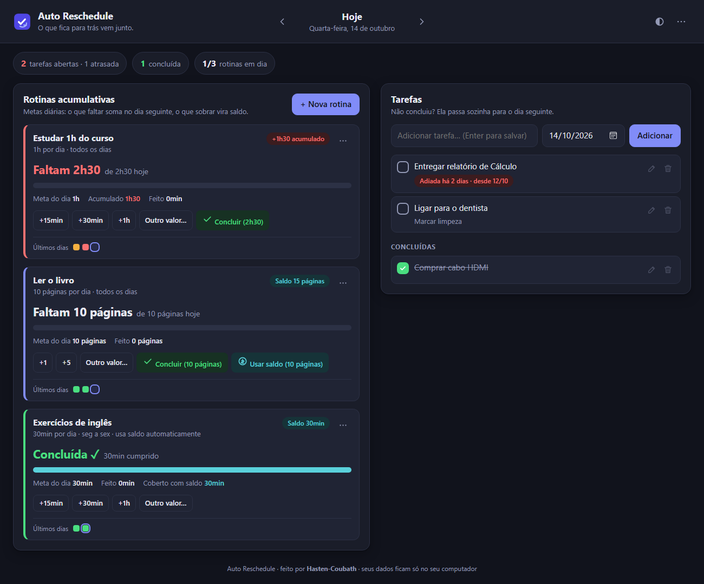

# ⏭️ Auto Reschedule

> **Uma lista de tarefas que não deixa nada para trás.**
> O que você não concluiu hoje vai sozinho para amanhã, e as metas diárias que ficaram pela metade **acumulam** até você pagar a diferença.


**Autor:** [Hasten-Coubath](https://github.com/Hasten-Coubath)



<details>
<summary>🌙 Ver no tema escuro</summary>



</details>

---

## 📑 Sumário

- [Sobre o projeto](#-sobre-o-projeto)
- [Funcionalidades](#-funcionalidades)
- [Como funciona (as regras)](#-como-funciona-as-regras)
  - [Tarefas que passam para o dia seguinte](#1-tarefas-que-passam-para-o-dia-seguinte)
  - [Rotinas acumulativas](#2-rotinas-acumulativas)
  - [Saldo](#3-saldo-fazer-a-mais-para-gastar-depois)
  - [Imprevistos: dispensar dia, pausar e limite de acúmulo](#4-imprevistos-dispensar-dia-pausar-e-limite-de-acúmulo)
- [Requisitos](#-requisitos)
- [Instalação](#-instalação)
- [Como usar](#-como-usar)
- [Iniciar junto com o Windows](#-iniciar-junto-com-o-windows)
- [Onde ficam os dados e como fazer backup](#-onde-ficam-os-dados-e-como-fazer-backup)
- [Estrutura do projeto](#-estrutura-do-projeto)
- [Arquitetura](#-arquitetura)
- [API local](#-api-local)
- [Testes](#-testes)
- [Privacidade e segurança](#-privacidade-e-segurança)
- [Solução de problemas](#-solução-de-problemas)
- [Ideias para o futuro](#-ideias-para-o-futuro)
- [Licença](#-licença)
- [Autor](#-autor)

---

## 💡 Sobre o projeto

Listas de tarefas comuns têm dois problemas:

1. Quando o dia acaba e você não marcou uma tarefa, ela simplesmente **some** (ou fica esquecida no passado).
2. Hábitos do tipo *"estudar 1h do curso por dia"* são tratados como "feito / não feito". Se você pulou um dia, a lista não te cobra a hora que ficou faltando.

O **Auto Reschedule** resolve os dois:

- **Tarefas não concluídas são reagendadas automaticamente** para o dia seguinte, com uma etiqueta mostrando há quantos dias estão atrasadas.
- **Rotinas acumulativas** guardam a diferença: se a meta é 1h e você não estudou hoje, amanhã a meta é **2h**. Fez só uma parte? Só o resto acumula. Estudou a mais? O excedente vira **saldo** para gastar em outro dia.

Ele roda **inteiramente no seu computador**: um pequeno servidor local em Python (sem nenhuma biblioteca externa) e uma interface que abre em uma janela própria. Nada vai para a internet.

---

## ✨ Funcionalidades

**Tarefas**
- ✅ Criar tarefas com data e anotações.
- ⏭️ Tarefa não concluída **passa sozinha para o dia seguinte** (e para o outro, e para o outro…) até ser marcada.
- 🏷️ Etiqueta "**Adiada há N dias · desde dd/mm**" para você ver o que está enrolando.
- ✏️ Editar, reabrir, excluir e adiar manualmente (mudando a data).
- ⚡ Concluir antes do prazo: a tarefa é registrada no dia em que foi feita.

**Rotinas acumulativas**
- ⏱️ Meta diária em **tempo** (`1h`, `30min`, `1h30`…) ou em **quantidade** (páginas, exercícios, questões…).
- 📈 **Acúmulo automático**: o que faltar hoje soma na meta de amanhã.
- ➖ **Abater parte**: registre o quanto fez (`+15min`, `+30min`, `+1h` ou qualquer valor) e só o restante acumula.
- 💰 **Saldo**: fez a mais? O excedente fica guardado. Gaste quando quiser com o botão **"Usar saldo"** (total ou parcial) — ou ative o **uso automático**.
- 📅 **Dias da semana**: escolha em quais dias a meta vale (todos, seg–sex, fins de semana ou qualquer combinação).
- 🛑 **Dispensar um dia** (imprevisto), **pausar** a rotina (férias, doença) e **limite de acúmulo** opcional.
- 🔁 Mudar a meta **não reescreve o passado**: a nova meta vale a partir da data que você escolher.
- 📊 **Histórico** dia a dia (meta, acumulado, feito, saldo usado, dívida, saldo) com opção de desfazer qualquer registro.
- 🟩 Mini-calendário dos **últimos 7 dias** em cada rotina.

**Geral**
- 🗓️ Navegue entre os dias (← →): veja o **passado** (e registre o que esqueceu de marcar) ou a **previsão** de dias futuros.
- 🌗 Tema claro e escuro (segue o sistema, com botão para alternar).
- 💾 Dados em um arquivo JSON local, com **gravação atômica** e **backup automático diário** (últimos 14 dias).
- 📤 Exportar backup com um clique.
- 🔌 **Zero dependências**: só precisa do Python instalado.

---

## 📐 Como funciona (as regras)

> O app **não precisa ficar aberto** para "virar o dia". Tudo é recalculado a partir dos seus registros sempre que você abre a tela. Pode ficar uma semana sem abrir que, ao voltar, as contas estarão certas.

### 1. Tarefas que passam para o dia seguinte

Uma tarefa tem uma **data**. A partir dessa data, ela aparece em **todos os dias** até ser concluída.

| Dia          | O que você vê                                                        |
|--------------|----------------------------------------------------------------------|
| Seg (12/10)  | "Entregar relatório" — pendente                                      |
| Ter (13/10)  | "Entregar relatório" — 🔴 *Adiada há 1 dia · desde 12/10*             |
| Qua (14/10)  | "Entregar relatório" — 🔴 *Adiada há 2 dias · desde 12/10* → ✅ feito |
| Qui (15/10)  | (não aparece mais)                                                   |

Se você navegar para um dia passado, verá a tarefa com a etiqueta *"Não concluída — passou para o dia seguinte"*.

### 2. Rotinas acumulativas

Uma rotina tem uma **meta por dia**. A cada dia o app calcula:

```
necessário hoje = meta do dia + acumulado dos dias anteriores
acumulado de amanhã = necessário hoje − (o que você fez + saldo que você usou)
```

**Exemplo** — rotina *"Estudar 1h do curso"*, todos os dias:

| Dia | Meta | Acumulado (veio de antes) | Necessário | Feito    | Resultado                         |
|-----|------|---------------------------|------------|----------|-----------------------------------|
| Seg | 1h   | —                         | 1h         | 30min    | faltou 30min → acumula            |
| Ter | 1h   | 30min                     | **1h30**   | —        | faltou 1h30 → acumula             |
| Qua | 1h   | 1h30                      | **2h30**   | 1h + 2h  | cumpriu e sobrou **30min de saldo** |
| Qui | 1h   | —                         | 1h         | …        |                                   |

Para **abater uma parte**, basta registrar o que você fez (botões `+15min`, `+30min`, `+1h`, "Outro valor…" ou "Concluir"). Você pode registrar várias vezes no mesmo dia; cada registro aparece como uma etiqueta no rodapé do cartão (com um ✕ para desfazer).

Formatos aceitos para tempo: `1h`, `30min`, `1h30`, `1h 30m`, `1:30`, `1,5h` ou só minutos (`90`).

### 3. Saldo (fazer a mais para gastar depois)

O que você fizer **além** do necessário vira **saldo**. Existem dois modos (configurável em cada rotina):

- **Manual (padrão):** o saldo fica guardado e você decide quando gastar. Quando houver pendência e saldo disponível, aparece o botão **"Usar saldo (X)"**, que cobre a pendência com o saldo. Pelo menu `⋯ → Usar parte do saldo…` dá para usar só uma parte.
- **Automático:** marque *"Usar o saldo automaticamente"* e o saldo cobre sozinho as pendências dos próximos dias.

Exemplo com uso automático, meta de 30min/dia: estudou 1h30 na segunda → sobrou 1h de saldo → terça e quarta já ficam ✅ automaticamente, cobertas pelo saldo.

> O que você faz a mais primeiro **paga o acumulado**; só o que sobra depois disso vira saldo.

### 4. Imprevistos: dispensar dia, pausar e limite de acúmulo

| Recurso | Para quê | Efeito |
|---|---|---|
| **Dias da semana** | A rotina só vale em certos dias (ex.: seg–sex) | Nos outros dias não entra meta nova, mas o acumulado continua esperando (e pode ser abatido). |
| **Dispensar este dia** (`⋯`) | Um imprevisto pontual | A meta *daquele dia* não é somada. O acumulado antigo continua. Pode ser desfeito. |
| **Pausar rotina** (`⋯`) | Férias, doença, semana de provas… | Enquanto pausada, nenhuma meta nova acumula. Ao **retomar**, a meta volta a valer a partir do dia da retomada. |
| **Limite de acúmulo** | Evitar uma "bola de neve" impossível | A dívida nunca passa do limite (ex.: 5h). O excedente é descartado e aparece como *"Descartado pelo limite"*. |
| **Mudar a meta** | Ex.: passar de 1h para 45min | Cria uma nova versão do plano que vale **a partir da data escolhida**. Os dias anteriores continuam calculados com a meta antiga. |

**Esqueceu de registrar ontem?** Volte para o dia (seta ← ou clique na data) e registre lá. Tudo é recalculado em cascata.

**Dias futuros** mostram uma **previsão**: quanto será necessário naquele dia se nada mais for feito até lá. Registros só podem ser feitos até hoje.

---

## 🧰 Requisitos

- **Python 3.9 ou mais recente** — [python.org/downloads](https://www.python.org/downloads/)
  - No Windows, marque a opção **"Add python.exe to PATH"** durante a instalação.
- Um navegador moderno. Para abrir em **janela própria** (sem barra de endereço), o app usa o **Microsoft Edge** (já vem no Windows) ou o **Google Chrome/Chromium**. Se nenhum for encontrado, abre no navegador padrão.

Não há `pip install`: o projeto usa apenas a biblioteca padrão do Python.

---

## 📥 Instalação

```bash
git clone https://github.com/Hasten-Coubath/auto-reschedule.git
cd auto-reschedule
```

Ou baixe o ZIP pelo botão **Code → Download ZIP** no GitHub e extraia em qualquer pasta.

---

## ▶️ Como usar

### Windows

- **Dê dois cliques em `iniciar.bat`.** Uma janela de console abre (deixe-a aberta) e o app aparece em uma janela própria.
- Prefere sem console? Use **`iniciar-sem-console.bat`**. Para encerrar, use o menu `⋯ → Encerrar aplicativo` dentro do app.

### Linux / macOS

```bash
chmod +x iniciar.sh   # só na primeira vez
./iniciar.sh
```

### Pela linha de comando (qualquer sistema)

```bash
python app.py
```

| Opção | Descrição |
|---|---|
| `--tab` | Abre como uma aba comum do navegador, em vez de janela própria. |
| `--no-browser` | Só inicia o servidor, sem abrir janela (útil para iniciar com o sistema). |
| `--port 9000` | Usa outra porta (padrão: `8765`). |
| `--data CAMINHO` | Usa outro arquivo de dados (ex.: uma pasta do OneDrive/Dropbox para sincronizar). |

Variáveis de ambiente equivalentes: `AUTO_RESCHEDULE_PORT` e `AUTO_RESCHEDULE_DATA`.

Depois de iniciado, o app também pode ser acessado em **http://127.0.0.1:8765**. Se você rodar o `iniciar.bat` com o app já aberto, ele apenas abre uma nova janela (não dá erro de porta ocupada).

### Atalhos de teclado

| Tecla | Ação |
|---|---|
| `←` / `→` | Dia anterior / próximo dia |
| `T` | Voltar para hoje |
| `N` | Ir para o campo "Adicionar tarefa" |
| `Enter` | Salvar (no campo de tarefa ou nos formulários) |
| `Esc` | Fechar janela/menu |

### Fluxo típico do dia

1. Abra o app — ele já mostra **hoje**, com o que ficou de ontem somado.
2. Fez um pedaço da rotina? Clique em `+30min` (ou "Outro valor…").
3. Terminou uma tarefa? Clique no quadradinho ✓.
4. Não deu tempo? Não faça nada: amanhã estará tudo lá.

---

## 🚀 Iniciar junto com o Windows

1. Pressione `Win + R`, digite `shell:startup` e dê Enter.
2. Nessa pasta, crie um **atalho** para o `iniciar-sem-console.bat` (botão direito → *Novo → Atalho*).
3. (Opcional) Para iniciar só o servidor, sem abrir a janela, edite o destino do atalho adicionando `--no-browser` no final. Depois é só acessar `http://127.0.0.1:8765` ou rodar o `iniciar.bat` quando quiser ver a lista.

---

## 💾 Onde ficam os dados e como fazer backup

| Item | Local |
|---|---|
| Dados | `data/dados.json` (dentro da pasta do projeto) |
| Backups automáticos | `data/backups/dados-AAAA-MM-DD.json` (um por dia, mantém os últimos 14) |

- A pasta `data/` está no `.gitignore`, então **seus dados pessoais não vão para o GitHub**.
- A gravação é **atômica** (escreve em um arquivo temporário e substitui): mesmo que o PC desligue no meio, o arquivo não corrompe.
- Se o arquivo de dados estiver corrompido (ex.: editado à mão com erro), ele é renomeado para `dados.corrompido-<data>.json` e o app começa vazio — nada é apagado.

**Exportar:** menu `⋯ → Exportar backup (JSON)`.

**Restaurar:** feche o app, copie o backup desejado para `data/dados.json` e abra o app de novo.

**Usar em mais de um computador:** aponte o `--data` para uma pasta sincronizada (OneDrive, Dropbox, Google Drive), por exemplo:

```bash
python app.py --data "C:/Users/voce/OneDrive/auto-reschedule/dados.json"
```

> Evite deixar o app aberto em dois computadores ao mesmo tempo com o mesmo arquivo.

---

## 🗂️ Estrutura do projeto

```
auto-reschedule/
├── app.py                    # Ponto de entrada: sobe o servidor e abre a janela
├── autoreschedule/
│   ├── __init__.py           # Versão e autor
│   ├── core.py               # Regras de negócio (rolagem, acúmulo, saldo) — puro, sem I/O
│   ├── storage.py            # Persistência em JSON, gravação atômica, backups diários
│   └── server.py             # Servidor HTTP local + API JSON (biblioteca padrão)
├── web/
│   ├── index.html            # Estrutura da interface
│   ├── styles.css            # Visual (tema claro/escuro, responsivo)
│   ├── app.js                # Lógica da interface (JavaScript puro, sem frameworks)
│   └── icon.svg              # Ícone
├── tests/
│   └── test_core.py          # Testes das regras de negócio
├── docs/                     # Imagens do README
├── iniciar.bat               # Atalho para Windows
├── iniciar-sem-console.bat   # Atalho para Windows sem janela de console
├── iniciar.sh                # Atalho para Linux/macOS
├── LICENSE
└── README.md
```

---

## 🏗️ Arquitetura

```
┌──────────────────────┐   HTTP (127.0.0.1)   ┌──────────────────────────┐
│  Janela do app       │ ───────────────────▶ │ server.py (http.server)  │
│  web/ (HTML/CSS/JS)  │ ◀─────────────────── │   └── core.py (regras)   │
└──────────────────────┘        JSON          │   └── storage.py (JSON)  │
                                              └────────────┬─────────────┘
                                                           ▼
                                                  data/dados.json
```

**Princípio central — nada é "rolado" na virada do dia.** O app guarda apenas *fatos* (tarefas com data e data de conclusão; rotinas com seus registros de progresso, uso de saldo e dias dispensados). O estado de qualquer dia é **recalculado** por uma simulação dia a dia em `core.simulate()`:

```
para cada dia, do início da rotina até o dia consultado:
    meta      = meta do plano vigente (0 se pausado, dispensado ou fora dos dias da semana)
    necessário = meta + dívida
    pago       = feito + saldo usado (manual) + saldo usado (automático, se ativo)
    se pago ≥ necessário: saldo += pago − necessário; dívida = 0
    senão:                dívida = necessário − pago (respeitando o limite, se houver)
```

Vantagens dessa abordagem:
- Funciona mesmo se o app ficar dias fechado (não depende de tarefa agendada).
- Registrar algo em um dia passado, ou desfazer um registro, corrige automaticamente todos os dias seguintes.
- Permite navegar no passado e ver previsões do futuro com a mesma função.

### Formato dos dados (`data/dados.json`)

```jsonc
{
  "version": 1,
  "tasks": [
    {
      "id": "a1b2c3d4e5f6",
      "title": "Entregar relatório de Cálculo",
      "notes": "",
      "date": "2026-10-12",          // data planejada
      "completed_on": null,          // data em que foi concluída (ou null)
      "created_at": "2026-10-12T09:00:00"
    }
  ],
  "routines": [
    {
      "id": "f6e5d4c3b2a1",
      "title": "Estudar 1h do curso",
      "unit": "time",                // "time" (minutos) ou "count"
      "unit_label": "min",           // ex.: "páginas" quando unit = "count"
      "start_date": "2026-10-12",
      "versions": [                  // histórico de metas (o passado não é reescrito)
        { "from": "2026-10-12", "amount": 60, "weekdays": [0,1,2,3,4,5,6] }
      ],
      "max_debt": null,              // limite de acúmulo (opcional)
      "auto_use_balance": false,     // usar saldo automaticamente
      "pauses": [ { "start": "2026-12-20", "end": "2027-01-05" } ],
      "entries": [                   // fatos registrados
        { "id": "...", "type": "progress", "date": "2026-10-12", "amount": 30 },
        { "id": "...", "type": "spend",    "date": "2026-10-14", "amount": 15 },
        { "id": "...", "type": "skip",     "date": "2026-10-15", "amount": 0 }
      ]
    }
  ]
}
```

Dias da semana seguem a convenção do Python: `0 = segunda … 6 = domingo`. Quantidades de tempo são guardadas em **minutos**.

---

## 🔌 API local

A interface conversa com o servidor por uma API JSON simples (útil se você quiser criar scripts ou integrações). Requisições que **alteram** dados precisam do cabeçalho `X-Auto-Reschedule: 1`.

| Método | Rota | Descrição |
|---|---|---|
| `GET` | `/api/ping` | Verifica se o app está rodando |
| `GET` | `/api/state?date=AAAA-MM-DD` | Estado de um dia (padrão: hoje): tarefas, rotinas e resumo |
| `GET` | `/api/export` | Baixa todos os dados (backup) |
| `POST` | `/api/shutdown` | Encerra o servidor |
| `POST` | `/api/tasks` | Cria tarefa `{title, date?, notes?}` |
| `PATCH` | `/api/tasks/{id}` | Edita `{title?, date?, notes?}` |
| `DELETE` | `/api/tasks/{id}` | Exclui |
| `POST` | `/api/tasks/{id}/complete` | Conclui `{date?}` |
| `POST` | `/api/tasks/{id}/reopen` | Reabre |
| `POST` | `/api/routines` | Cria rotina `{title, unit, amount, weekdays?, start_date?, unit_label?, max_debt?, auto_use_balance?, notes?}` |
| `PATCH` | `/api/routines/{id}` | Edita (mudança de `amount`/`weekdays` vale a partir de `effective_from`) |
| `DELETE` | `/api/routines/{id}` | Exclui a rotina e seu histórico |
| `GET` | `/api/routines/{id}/history?date=&days=30` | Histórico dia a dia + registros |
| `POST` | `/api/routines/{id}/entries` | Registra `{type: "progress" \| "spend" \| "skip", date?, amount?}` |
| `DELETE` | `/api/routines/{id}/entries/{entryId}` | Desfaz um registro |
| `POST` | `/api/routines/{id}/pause` | Pausa a partir de hoje |
| `POST` | `/api/routines/{id}/resume` | Retoma a partir de hoje |

Exemplo (PowerShell):

```powershell
Invoke-RestMethod -Method Post -Uri http://127.0.0.1:8765/api/tasks `
  -Headers @{ "X-Auto-Reschedule" = "1" } -ContentType "application/json" `
  -Body '{"title": "Pagar a fatura", "date": "2026-10-20"}'
```

---

## 🧪 Testes

As regras de negócio (acúmulo, saldo, pausa, limite, rolagem de tarefas etc.) têm testes automatizados com `unittest`, também sem dependências:

```bash
python -m unittest discover -s tests -v
```

Para **simular outro dia** sem mexer no relógio do computador (útil para testar o acúmulo), defina a variável `AUTO_RESCHEDULE_TODAY`:

```powershell
# PowerShell
$env:AUTO_RESCHEDULE_TODAY = "2026-12-25"; python app.py --data teste.json
```

```bash
# Linux/macOS
AUTO_RESCHEDULE_TODAY=2026-12-25 python3 app.py --data teste.json
```

---

## 🔒 Privacidade e segurança

- O servidor escuta **somente em `127.0.0.1`**: nenhum outro computador da rede consegue acessá-lo.
- Nenhum dado é enviado para a internet; não há contas, telemetria nem bibliotecas de terceiros.
- Requisições que alteram dados exigem um cabeçalho próprio, o que impede que **sites abertos no seu navegador** mexam nas suas tarefas (proteção contra CSRF).
- O cabeçalho `Host` é validado, protegendo contra ataques de *DNS rebinding*.

---

## 🛠️ Solução de problemas

<details>
<summary><b>"python" não é reconhecido como um comando</b></summary>

O Python não está instalado ou não está no PATH. Instale pelo [python.org](https://www.python.org/downloads/) marcando **"Add python.exe to PATH"**. O `iniciar.bat` também tenta usar o lançador `py`, que vem com o instalador oficial.
</details>

<details>
<summary><b>"Não foi possível usar a porta 8765"</b></summary>

Outro programa está usando a porta. Inicie com outra: `python app.py --port 8800`.
</details>

<details>
<summary><b>Abriu como aba do navegador em vez de janela própria</b></summary>

O modo janela depende do Edge, Chrome ou Chromium. Se nenhum for encontrado, o app abre no navegador padrão — funciona igual.
</details>

<details>
<summary><b>Usei o iniciar-sem-console.bat e não sei como fechar</b></summary>

Use o menu `⋯ → Encerrar aplicativo` na janela do app. Fechar só a janela deixa o servidor rodando em segundo plano (ele usa pouquíssimos recursos); ao abrir o `.bat` de novo, ele reaproveita o servidor existente.
</details>

<details>
<summary><b>A meta acumulou demais e ficou impossível</b></summary>

Edite a rotina e defina um **limite de acúmulo**, use **Dispensar este dia** nos dias de imprevisto, ou **pause** a rotina durante férias. Você também pode excluir registros no **Histórico**.
</details>

<details>
<summary><b>Registrei algo errado</b></summary>

Clique no ✕ da etiqueta do registro (rodapé do cartão da rotina) ou abra `⋯ → Histórico` e exclua o registro. Tudo é recalculado.
</details>

---

## 🧭 Ideias para o futuro

- [ ] Notificações na área de trabalho no fim do dia
- [ ] Gráficos de evolução por rotina
- [ ] Categorias / etiquetas e prioridades para tarefas
- [ ] Tarefas recorrentes simples (sem acúmulo)
- [ ] Importar backup pela própria interface
- [ ] Empacotar como executável (`.exe`) com PyInstaller

Sugestões e *pull requests* são bem-vindos!

---

## 📄 Licença

Distribuído sob a licença **MIT**. Veja o arquivo [LICENSE](LICENSE) para mais detalhes.

---

## 👤 Autor

Desenvolvido por **Hasten-Coubath**.

- GitHub: [@Hasten-Coubath](https://github.com/Hasten-Coubath)

Se este projeto te ajudou a não deixar os estudos acumularem, deixe uma ⭐ no repositório!
